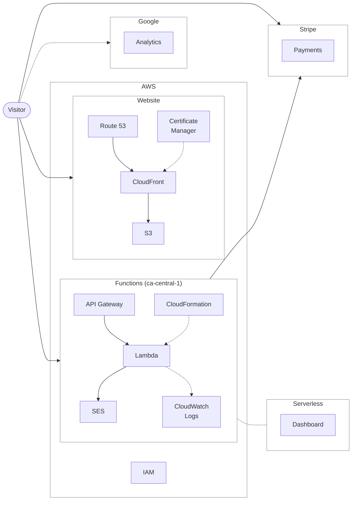

## Personal Website

<div align="center">

[](https://forthebadge.com) [](https://forthebadge.com)

[](https://github.com/raaedkabir/personal-website/actions/workflows/main.yml)

</div>

---

**Local Development**

Requires the Node version in `.nvmrc` and [pnpm](https://pnpm.io/installation) (pinned via `packageManager` in `package.json`, so `corepack enable` will pick it up).

```bash
pnpm install    # install dependencies
pnpm dev        # dev server on localhost:3000
pnpm generate   # static build to /dist
pnpm storybook  # Storybook on localhost:6006
pnpm test       # check every story and page for accessibility issues
```

`pnpm install` also sets up [Husky](https://typicode.github.io/husky/) git hooks:

- `pre-commit` runs `pnpm lint`
- `commit-msg` runs [commitlint](https://commitlint.js.org/), so commit messages must follow [Conventional Commits](https://www.conventionalcommits.org/) (e.g. `feat: add contact form`, `fix(blog): correct styles`)
- `pre-push` runs `pnpm run audit`, which uses [audit-ci](https://github.com/IBM/audit-ci) to fail on moderate or worse advisories. Configure the threshold and allowlist in `audit-ci.json` (use `pnpm run audit`, since `pnpm audit` is pnpm's built-in command)

Pull requests run the same checks in CI: the `Lint` workflow runs `pnpm lint`, the `Commitlint` workflow checks every commit in the PR plus the PR title, which becomes the commit message when the PR is squash-merged, and the `Audit` workflow runs `pnpm run audit`.

---

**Storybook**

`pnpm storybook` starts [Storybook](https://storybook.js.org/) with a docs page and stories for each of the `App*` UI components, built with the site's own Nuxt config and styles. Stories live next to their components (`*.stories.ts`). The [Accessibility addon](https://storybook.js.org/docs/writing-tests/accessibility-testing)'s panel checks the open story with axe, and the [Vitest addon](https://storybook.js.org/docs/writing-tests/integrations/vitest-addon)'s test widget in the sidebar runs every story as a test. `pnpm build-storybook` builds a static copy into `storybook-static/`.

---

**Accessibility Tests**

`pnpm test` checks the site with [axe-core](https://github.com/dequelabs/axe-core) and fails on any WCAG 2.2 A/AA or axe best-practice violation. It runs two suites, which check the same rules (`tests/axe.ts`):

- `pnpm test:stories` renders every Storybook story in Chromium with [Vitest](https://vitest.dev/), runs its play function and checks it with the Accessibility addon. Stories reach states that pages don't show when they load, like an open modal.
- `pnpm test:a11y` prerenders the site and scans every page, the 404 page and the open navigation menu in [Playwright](https://playwright.dev/), at a desktop and a phone viewport. Run `pnpm exec playwright test` to rescan an existing build.

Run `pnpm exec playwright install chromium` once before the first run. Pull requests run both suites in the `Accessibility` workflow, which uploads the Playwright report with the full axe results for each page.

---

**AWS Hosting**

- DNS setup with Route 53
- SSL Certificate from Certificate Manager
- Static hosting on S3
- Distribution with CloudFront

---

**CI/CD Build Pipeline using GitHub Actions**

1. Merge code to main branch
2. Run build
3. Assume the deploy IAM role via GitHub OIDC (no long-lived AWS keys)
4. Upload /dist to S3
5. Invalidate CloudFront's cache
6. Deploy the Lambda functions in `functions/` with Serverless Framework (in parallel with steps 2–5)

Repository secrets: `AWS_ROLE_ARN`, `BUCKET_ID`, `CLOUDFRONT_ID`, `SERVERLESS_ACCESS_KEY` and `STRIPE_SECRET_KEY`.

---

**Pull Request Previews**

The `Preview` workflow builds every pull request and deploys it to `https://pr-<number>.preview.raaedkabir.com`. The link shows up on the pull request as a deployment to the `preview` environment, and the preview is deleted when the pull request closes. Previews don't send Google Analytics hits and tell search engines not to index them. They call the production Lambda functions, so the contact form sends real emails, and changes to `functions/` aren't previewed. Pull requests from forks aren't deployed, since their workflows get no AWS credentials.

All previews share one private S3 bucket, with a folder per pull request, behind one CloudFront distribution whose CloudFront Function picks the folder from the subdomain. `infra/preview/template.yml` is a CloudFormation stack with the bucket, the distribution, a `*.preview.raaedkabir.com` certificate, the DNS records and an IAM role that can only write to the bucket. To set it up once:

1. Deploy the stack in `us-east-1` (CloudFront only uses certificates from there), passing the ID of the `raaedkabir.com` Route 53 hosted zone. The role uses the account's existing GitHub OIDC provider. Validating the certificate and creating the distribution take several minutes.

   ```bash
   aws cloudformation deploy --region us-east-1 --stack-name personal-website-preview --template-file infra/preview/template.yml --capabilities CAPABILITY_IAM --parameter-overrides HostedZoneId=<hosted-zone-id>
   ```

2. Read the stack's outputs:

   ```bash
   aws cloudformation describe-stacks --region us-east-1 --stack-name personal-website-preview --query 'Stacks[0].Outputs' --output table
   ```

3. Add them as repository variables (Settings → Secrets and variables → Actions → Variables): `BucketName` as `PREVIEW_BUCKET` and `DeployRoleArn` as `PREVIEW_AWS_ROLE_ARN`. The workflow skips its jobs while `PREVIEW_BUCKET` is unset, which is why these are variables rather than secrets; neither grants access on its own. Push to an open pull request, or close and reopen it, to deploy its first preview.

A pull request can edit its own workflow files, so the preview role trusts only pull request runs and can only touch the preview bucket. The production `AWS_ROLE_ARN` role should likewise trust only `main` (`repo:raaedkabir/personal-website:ref:refs/heads/main`).

---

**Dashboards & Consoles**

Live site: [www.raaedkabir.com](https://www.raaedkabir.com/)

| Provider | Console | Notes |
| --- | --- | --- |
| **AWS** | [Route 53](https://console.aws.amazon.com/route53/v2/hostedzones) | DNS hosted zone, including the `*.preview` records for pull request previews |
| | [Certificate Manager](https://us-east-1.console.aws.amazon.com/acm/home?region=us-east-1#/certificates/list) | SSL certificates for the site and `*.preview.raaedkabir.com` (`us-east-1`, as CloudFront requires) |
| | [S3](https://console.aws.amazon.com/s3/buckets) | Site bucket (`BUCKET_ID`) and preview bucket (`PREVIEW_BUCKET`); resume, demo video and email images are in [`raaedkabir-assets`](https://console.aws.amazon.com/s3/buckets/raaedkabir-assets) |
| | [CloudFront](https://console.aws.amazon.com/cloudfront/v4/home#/distributions) | Site distribution (`CLOUDFRONT_ID`), and the preview distribution with its viewer-request function |
| | [IAM roles](https://console.aws.amazon.com/iam/home#/roles) / [identity providers](https://console.aws.amazon.com/iam/home#/identity_providers) | Deploy roles (`AWS_ROLE_ARN`, `PREVIEW_AWS_ROLE_ARN`) and the GitHub OIDC provider they trust |
| | [Lambda](https://ca-central-1.console.aws.amazon.com/lambda/home?region=ca-central-1#/functions) | `contact-lambda-dev-contact` and `stripe-lambda-dev-stripe` (`ca-central-1`) |
| | [API Gateway](https://ca-central-1.console.aws.amazon.com/apigateway/main/apis?region=ca-central-1) | `POST /dev/contact` and `POST /dev/stripe` endpoints |
| | [CloudFormation](https://ca-central-1.console.aws.amazon.com/cloudformation/home?region=ca-central-1#/stacks) | Serverless stacks `contact-lambda-dev` and `stripe-lambda-dev`; the preview stack `personal-website-preview` is in [`us-east-1`](https://us-east-1.console.aws.amazon.com/cloudformation/home?region=us-east-1#/stacks) |
| | [CloudWatch Logs](https://ca-central-1.console.aws.amazon.com/cloudwatch/home?region=ca-central-1#logsV2:log-groups) | Function logs under `/aws/lambda/` |
| | [SES](https://ca-central-1.console.aws.amazon.com/ses/home?region=ca-central-1#/identities) | Verified sender identity for the contact form |
| **Serverless** | [Dashboard](https://app.serverless.com/raaedkabir) | Org `raaedkabir`, app `personal-website`: function deploys, and the access key for `SERVERLESS_ACCESS_KEY` |
| **Stripe** | [Payments](https://dashboard.stripe.com/payments) / [API keys](https://dashboard.stripe.com/apikeys) | Card payments; `STRIPE_SECRET_KEY` |
| **Google** | [Analytics](https://analytics.google.com/) | Measurement ID `G-HWHNZXBHTF` |



---

**Problems with Configuring Client-Side Routing (for SPAs)**

- Setting the Error Document in S3 makes potential valid URLs treated as 404s
- Customizing the Error Response in CloudFront treats invalid URLs as 200s
- Adding a Lamda@Edge Viewer Request Interceptor to check the route against known routes will correctly serve 200s and 404s respectively but will require extra work of updating the list of known routes

This webapp was using the third option but has instead now migrated to Nuxt. But for reference the Lamda@Edge code is still here:

```js
// array of known routes
const pages = [...known_routes]

exports.handler = (event, context, callback) => {
  const request = event.Records[0].cf.request

  // replace URI if route is valid
  if (pages.indexOf(request.uri.slice(1)) > -1) {
    request.uri = '/index.html'
  }

  // pass route back to request
  callback(null, request)
}
```
